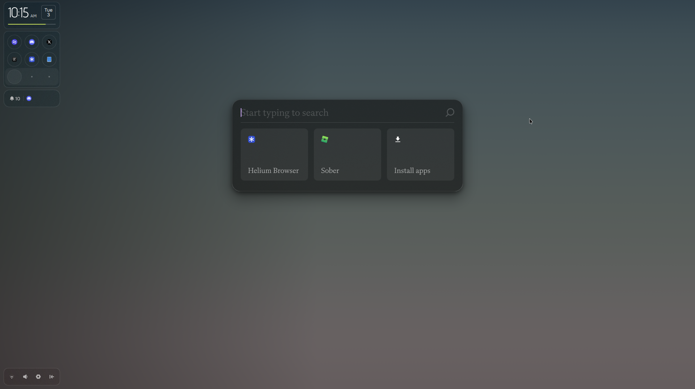
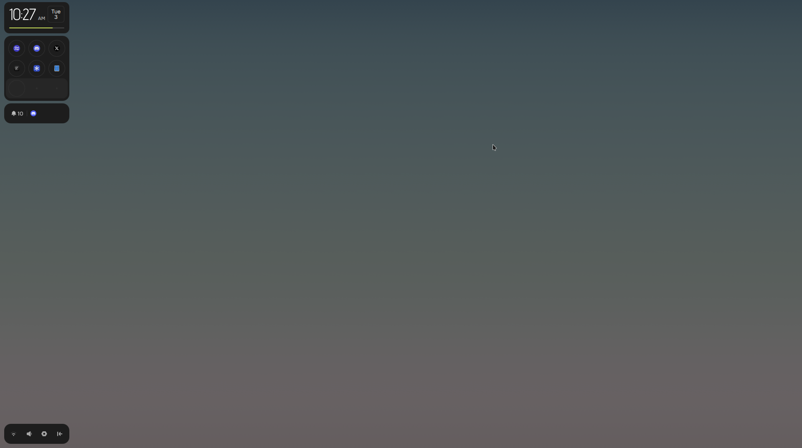

Good morning! Today I'm using [Pond Linux (by Butterfly)](https://www.butterfly.so/pond),
a new Linux distribution based on Arch. It mostly looks like "yet another dotfile"
setup, but this time it takes a different approach. It has some interesting features and
optimizations that I'd like to take a look at.

# First Impression

I started with Pond's live ISO. (I haven't tried the Windows installer, since I only use
Linux, unfortunately.) The design seemed more interesting than I expected, though it
sticks closely to the design system they put in place.

The installation itself is seamless and feels flawless, except for the Wi-Fi connection,
which felt abysmal and caused the installation to fail twice. Even so, the ISO only weighs
about 1.3 GB in total. There isn't much going on, unlike Omarchy, which I personally find
to be one of the worst Arch-based distros.

On the desktop, Pond uses [Niri](https://github.com/niri-wm/niri) and
[Quickshell](https://quickshell.org). It's an interesting choice. I used Niri before, so the
experience felt familiar. In Niri, windows are organized spatially: each workspace is a
strip of columns, and each column can hold one or more windows. It looks similar to other
tiling window managers, but the underlying concept is different, since Niri is a scrolling
window manager.

The user experience feels good overall. On first boot, the user manual opens automatically
to teach you how to use the desktop. That's important for first-time users, since the
desktop works quite differently from macOS and Windows. I picked it up quickly, but it's a
helpful touch for anyone new.

Pond's spotlight is a fork of Vicinae, which brings Raycast compatibility. (I mean
compatibility, not full support, since some extensions rely on APIs that are only available
on macOS or Windows.) I like the design, since it shows only three recently used actions or
applications. The best part is that it's open source, just like Vicinae.

Since Pond is based on [Arch Linux](https://archlinux.org/), you can install software from
pacman packages, Flatpak (preinstalled, though Arch doesn't include it by default), and
more. AUR packages are also possible, but they carry security risks, so please check the
`PKGBUILD` before installing!

## Customization

There isn't much customization in this distribution. You can only change the theme and
wallpaper.

Despite being in public early access, there are only two themes (with a third coming soon).
I'll show them below.

### Unthemed

### Daylight (Personal Favorite)

# Final Thought

To conclude, Pond seems solid to me, but it lacks some features I wanted. Even so, I love
this distribution after almost a week of use. I haven't found any bugs so far, but since
it's still in early access, you may run into unexpected issues or behavior. If you do,
please report them on GitHub, as always.

It's been a while since I last wrote a review, but I'm glad I did.
